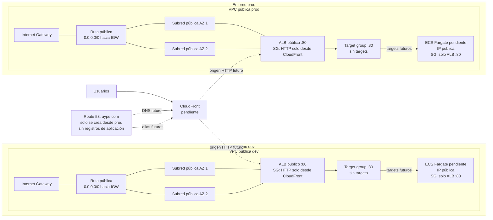

# Terraform

La infraestructura se organiza por capas y entornos. La capa `01-network` crea
una VPC con dos subredes públicas en distintas zonas de disponibilidad, un
Internet Gateway, rutas públicas, una zona Route 53 compartida, y un ALB con
grupos de seguridad para CloudFront y las tareas frontend. No crea NAT Gateways,
subredes privadas ni servicios de aplicación.

## Requisitos

- Terraform 1.5 o posterior.
- Credenciales de AWS con permisos para administrar VPC y acceso al backend.
- El bucket S3 `aype-tfstate-portfolio` y la tabla DynamoDB `terraform-locks`
  deben existir antes de inicializar Terraform.

## Red

El diagrama muestra los recursos definidos por Terraform hasta ahora; todavía
no implica que hayan sido aplicados en AWS.



Cada VPC usa dos subredes públicas en distintas zonas de disponibilidad, con
rutas al Internet Gateway y sin NAT Gateway. El SG del ALB permite HTTP desde el
prefix list administrado de CloudFront; el SG frontend permite el puerto 80
solo desde el SG del ALB. La zona de Route 53 se crea una sola vez en `prod`.

Desde `terraform/layers/01-network`, inicializa y planifica cada entorno con su
configuración correspondiente:

```bash
terraform init -reconfigure -backend-config=environments/dev.backend.hcl
terraform plan -var-file=environments/dev.tfvars
```

Para producción, usa `prod` en ambos archivos:

```bash
terraform init -reconfigure -backend-config=environments/prod.backend.hcl
terraform plan -var-file=environments/prod.tfvars
```

Cada entorno tiene su propio estado S3. La clave de estado de `prod` conserva la
ruta previamente configurada (`layers/01-network/terraform.tfstate`); `dev` usa
`layers/dev/01-network/terraform.tfstate`.

La zona `aype.com` se crea solo al aplicar el entorno `prod`, para evitar zonas
duplicadas. Luego de aplicar, configura en el registrador los name servers
expuestos por el output `route53_name_servers`. La zona no registra ni renueva el
dominio.

Cada entorno crea su propio ALB y target group. El ALB acepta HTTP desde el
prefix list administrado de CloudFront; el grupo de seguridad frontend acepta
tráfico del puerto 80 únicamente desde el SG del ALB. Al desplegar Fargate en
subredes públicas, habilita la asignación de IP pública y usa el output
`frontend_security_group_id` en el servicio ECS.

El target group quedará sin targets hasta desplegar ECS y asociar el servicio.
CloudFront, los registros DNS de la aplicación y HTTPS entre CloudFront y el ALB
se incorporarán en la capa de edge/certificados. El prefix list restringe el
origen a la red de CloudFront, no a una distribución específica.